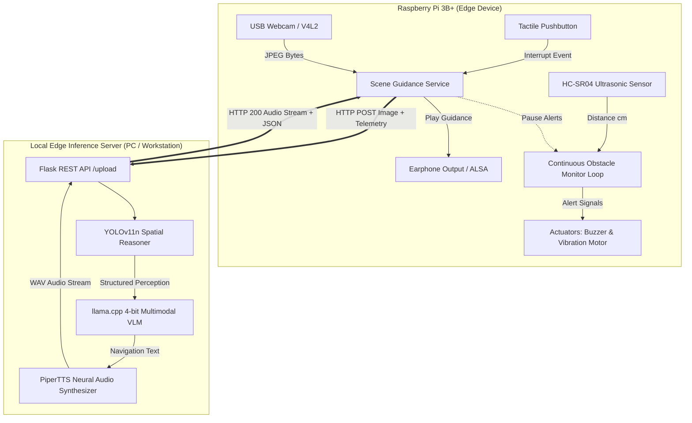

V# Smart AI-Assisted Navigation Stick for Visually Impaired Users

[](https://www.python.org/)
[](https://www.raspberrypi.com/)
[](https://github.com/ultralytics/ultralytics)
[-green.svg)](https://github.com/rhasspy/piper)
[](https://palletsprojects.com/p/flask/)
[](LICENSE)

A distributed edge AI mobility system combining real-time spatial computer vision and local multimodal language model inference to provide assistive environmental awareness and tactile/spoken navigation guidance for visually impaired individuals.

---

## Table of Contents

- [Overview](#overview)
- [Key Features](#key-features)
- [System Architecture](#system-architecture)
- [End-to-End Latency Benchmark](#end-to-end-latency-benchmark)
- [Repository Structure](#repository-structure)
- [Installation & Setup](#installation--setup)
  - [1. Local AI Inference Server](#1-local-ai-inference-server)
  - [2. Raspberry Pi 3B+ Edge Client](#2-raspberry-pi-3b-edge-client)
  - [3. Desktop Simulation Mode](#3-desktop-simulation-mode)
- [Configuration](#configuration)
- [API Reference](#api-reference)
- [Systemd Deployment](#systemd-deployment)
- [Testing](#testing)
- [License](#license)

---

## Overview

Traditional white canes identify physical obstacles only upon direct mechanical contact within immediate arm's reach. This project implements a smart assistive navigation stick that pairs **low-latency edge sensing** with **local multimodal reasoning**:

1. **Continuous Edge Obstacle-Monitoring**: Fuses an HC-SR04 ultrasonic rangefinder with YOLOv11n directional spatial zoning, driving dual acoustic (buzzer) and tactile (vibration motor) alerts in real time.
2. **Interruptible Guidance Loop**: A tactile pushbutton triggers on-demand contextual scene captioning, temporarily silencing obstacle alarms so the user receives clear spoken navigation instructions via earphones.
3. **Local Multimodal Inference**: Replaces high-latency cloud pipelines with a 4-bit quantized multimodal model (`gemma-3-4b-it-GGUF:Q4_K_M`) hosted on a local workstation server via `llama.cpp`. This drops end-to-end processing latency by over **50%** (from **6–8 seconds down to under 3 seconds**), ensuring complete privacy with zero cloud dependency.
4. **Sub-150ms Neural Speech Synthesis**: Synthesizes natural spoken navigational directions using PiperTTS directly into the user's earphones.

---

## Key Features

- **Continuous 3-Zone Spatial Zoning**: Frame corridor is dynamically partitioned into `LEFT` (0–33%), `CENTER` (33–66%), and `RIGHT` (66–100%) zones. Obstacles directly in the user's walking path (center corridor) are assigned critical priority.
- **Multimodal Haptic & Acoustic Alerts**:
  - *Critical Proximity (<40 cm / Center path hazard)*: High-frequency rapid buzzer beeps + continuous vibration.
  - *Warning Proximity (40–80 cm / Lateral hazard)*: Pulsing vibration motor warning.
  - *Safe (>80 cm / Clear path)*: Actuators silent.
- **Interruptible On-Demand Scene Captioning**: Pressing the stick's tactile pushbutton immediately halts buzzer/vibration alerts, transmits the camera frame + sensor telemetry to the local server, and delivers spoken guidance through 3.5mm earphones.
- **Hardware Abstraction Layer (HAL)**: Includes automatic `MockGPIO` and synthetic camera generation, enabling full desktop development and headless automated testing without physical Raspberry Pi hardware.
- **Resilient Fallback Pipeline**: Server seamlessly falls back from local llama.cpp to Google Gemini Vision and gTTS if configured, allowing direct latency profiling against cloud architectures.

---

## System Architecture




---

## End-to-End Latency Benchmark

The local multimodal inference server achieves a **~50–65% reduction in total end-to-end response time** compared with the cloud baseline pipeline:
```text
==============================================================================
               SMART BLIND STICK - LATENCY EVALUATION BENCHMARK
==============================================================================
Metric / Pipeline Phase             | Cloud (Gemini + gTTS) | Local (YOLO + Ollama)
------------------------------------------------------------------------------
Image Transmission                  |      323.3 ms         |       13.5 ms
Vision Preprocessing (YOLOv11n)     |      N/A              |       38.2 ms
Vision-Language Inference (Gemini)  |     4552.6 ms         |       N/A
Text-based LLM Inference (Ollama)   |      N/A              |     2154.8 ms
Speech Synthesis                    |     1772.7 ms (gTTS)  |      124.3 ms (Piper)
Audio Download / Delivery           |      399.6 ms         |       11.9 ms
------------------------------------------------------------------------------
TOTAL END-TO-END LATENCY            |       7.05 s          |       2.34 s
==============================================================================
RESULTS: 66.76% Lower End-to-End Latency
SPEEDUP: 3.01x faster local guidance
PRIVACY: Fully offline local inference pipeline
==============================================================================
```

To run this benchmark evaluation directly on your machine:

```bash
python3 -m benchmarks.latency_comparison
```

---

## Repository Structure

```
Smart-Blind-Stick/
├── README.md                      # Comprehensive project documentation
├── LICENSE                        # MIT License
├── .gitignore                     # Build artifacts, models, caches, and secrets
├── .env.example                   # Environment configuration template
├── requirements.txt               # Server & workstation Python dependencies
├── requirements-pi.txt            # Lightweight Raspberry Pi client dependencies
│
├── config/                        # Centralized configuration management
│   ├── __init__.py
│   ├── settings.py                # Type-safe dataclass settings with ENV overrides
│   └── default_config.yaml        # Default parameters (pins, thresholds, endpoints)
│
├── edge/                          # Raspberry Pi 3B+ Edge Client
│   ├── __init__.py
│   ├── main.py                    # Edge entry point: thread orchestration & event loop
│   ├── obstacle_monitor.py        # Continuous ultrasonic + YOLO obstacle monitor
│   ├── scene_guidance.py          # Interruptible button-triggered scene captioner
│   ├── run_edge.sh                # Edge client startup shell script
│   └── hardware/                  # Hardware Abstraction Layer (HAL)
│       ├── __init__.py
│       ├── gpio_controller.py     # HC-SR04, Buzzer, Vibration & MockGPIO fallback
│       ├── camera.py              # Low-latency OpenCV V4L2 capture with buffer purge
│       └── audio_output.py        # ALSA / mpg123 / aplay earphone playback engine
│
├── server/                        # Local Edge AI Inference Server
│   ├── __init__.py
│   ├── app.py                     # Flask REST API (/upload, /audio, /status, /say)
│   ├── llm_engine.py              # llama.cpp 4-bit llm engine
│   ├── tts_engine.py              # Sub-150ms PiperTTS neural synthesizer
│   ├── vision_pipeline.py         # YOLOv11n spatial zoning & corridor reasoning
│   └── run_server.sh              # Server startup script
│
├── vision/                        # Spatial Perception Utilities
│   ├── __init__.py
│   ├── detector.py                # YOLOv11n model loader & class filtering
│   ├── spatial_reasoning.py       # 3-Zone horizontal corridor & threat scoring
│   └── scene_builder.py           # Natural language prompt generator for LLM
│
├── benchmarks/                    # Latency Profiling Suite
│   ├── __init__.py
│   ├── latency_comparison.py      # Automated benchmark comparing Local vs Cloud
│   └── benchmark_results.json     # Empirical trial results & metrics breakdown
│
├── systemd/                       # Production Linux service definitions
│   ├── smart-stick-edge.service   # Systemd unit for Raspberry Pi client
│   └── smart-stick-server.service # Systemd unit for AI inference server
│
└── tests/                         # Automated unit & integration tests
    ├── __init__.py
    ├── test_hardware_mock.py      # MockGPIO, actuators, and sensor unit tests
    ├── test_spatial_reasoning.py  # Corridor zoning & proximity classification tests
    └── test_server_api.py         # Flask endpoints & payload contract tests
```

---

## Installation & Setup

### 1. Local AI Inference Server

Run the server on a local machine (e.g., laptop or workstation with GPU or fast multi-core CPU on the same local network):

```bash
# Clone the repository
git clone https://github.com/your-username/Smart-Blind-Stick.git
cd Smart-Blind-Stick

# Install server dependencies
pip install -r requirements.txt

# (Optional) Download quantized GGUF multimodal model for llama.cpp:
# Example: gemma-3-4b-it-GGUF:Q4_K_M
mkdir -p models
# Download your preferred GGUF and vision projector into models/

# Launch the server
./server/run_server.sh
# Server will listen on http://0.0.0.0:5000
```

### 2. Raspberry Pi 3B+ Edge Client

On the Raspberry Pi attached to the smart stick:

```bash
# Clone repository onto Raspberry Pi
git clone https://github.com/your-username/Smart-Blind-Stick.git
cd Smart-Blind-Stick

# Install lightweight dependencies
sudo apt-get update
sudo apt-get install -y python3-opencv mpg123 alsa-utils
pip install -r requirements-pi.txt

# Copy and configure environment variables
cp .env.example .env
nano .env  # Update STICK_EDGE_SERVER_URL to point to your server IP

# Launch the edge client
./edge/run_edge.sh
```

### 3. Desktop Simulation Mode

You can run and test both the client and server on any desktop PC (Linux, macOS, or Windows) without physical hardware:

```bash
# Terminal 1: Run the server in mock/local mode
python3 -m server.app

# Terminal 2: Run the edge client with mock hardware and synthetic camera
python3 -m edge.main --simulate-hardware --server http://localhost:5000
```

---

## Configuration

Settings can be customized in `config/default_config.yaml` or overridden via environment variables in `.env`:

| Environment Variable | Default | Description |
|---|---|---|
| `STICK_SERVER_PORT` | `5000` | Port for Flask inference server |
| `STICK_EDGE_SERVER_URL` | `http://192.168.1.100:5000` | Server address accessed by Pi client |
| `STICK_SIMULATE_HARDWARE` | `false` | Enable MockGPIO and synthetic webcam |
| `STICK_INFERENCE_ENGINE` | `local` | `local` (llama.cpp) \| `cloud` (Gemini) \| `mock` |
| `STICK_TTS_ENGINE` | `piper` | `piper` (neural, <150ms) \| `gtts` \| `mock` |
| `STICK_PIN_TRIG` | `23` | BCM pin for HC-SR04 Trigger |
| `STICK_PIN_ECHO` | `24` | BCM pin for HC-SR04 Echo |
| `STICK_PIN_BUZZER` | `18` | BCM pin for Active Buzzer |
| `STICK_PIN_VIBRATION` | `25` | BCM pin for Vibration Motor |
| `STICK_PIN_BUTTON` | `17` | BCM pin for Tactile Pushbutton |
| `STICK_DISTANCE_CRITICAL_CM` | `40.0` | Threshold (cm) for urgent buzzer & vibration |
| `STICK_DISTANCE_WARNING_CM` | `80.0` | Threshold (cm) for warning vibration |

---

## API Reference

### `POST /upload`
Receives a JPEG snapshot from the walking stick, executes YOLOv11n spatial reasoning, runs multimodal inference, and returns spoken audio.

- **Headers**:
  - `Content-Type: image/jpeg`
  - `X-Ultrasonic-Distance: <distance_in_cm>`
  - `X-User-Query: <optional_custom_prompt>`
- **Response** `(200 OK)`:
  ```json
  {
    "status": "success",
    "audio_url": "/audio/7f8a32b1...",
    "description": "Chair directly ahead in the center path. Path to the left is open.",
    "latency": {
      "vision_ms": 38.2,
      "inference_ms": 2154.8,
      "tts_ms": 124.3,
      "total_ms": 2317.3
    },
    "engine": "llama.cpp (4-bit local)",
    "obstacles": [
      {
        "label": "chair",
        "direction": "center",
        "proximity": "near",
        "threat_level": "critical",
        "confidence": 0.89
      }
    ]
  }
  ```

### `GET /audio/<audio_id>`
Streams the generated PiperTTS audio file (WAV format) directly to the Raspberry Pi for earphone playback.

### `GET /status` / `GET /health`
Returns system status, active inference engine, model names, and queue health.

### `GET /benchmark`
Returns comparative latency benchmark results between Cloud and Local Edge pipelines.

---

## Systemd Deployment

To run the applications automatically on boot:

1. **On the Raspberry Pi**:
   ```bash
   sudo cp systemd/smart-stick-edge.service /etc/systemd/system/
   sudo systemctl daemon-reload
   sudo systemctl enable --now smart-stick-edge.service
   ```

2. **On the AI Inference Server**:
   ```bash
   sudo cp systemd/smart-stick-server.service /etc/systemd/system/
   sudo systemctl daemon-reload
   sudo systemctl enable --now smart-stick-server.service
   ```

---

## Testing

The project includes unit and integration tests covering hardware mocks, spatial reasoning algorithms, prompt builders, and API contracts:

```bash
# Run all unit tests
python3 -m unittest discover tests

# Or with pytest
pytest tests/ -v
```

---
